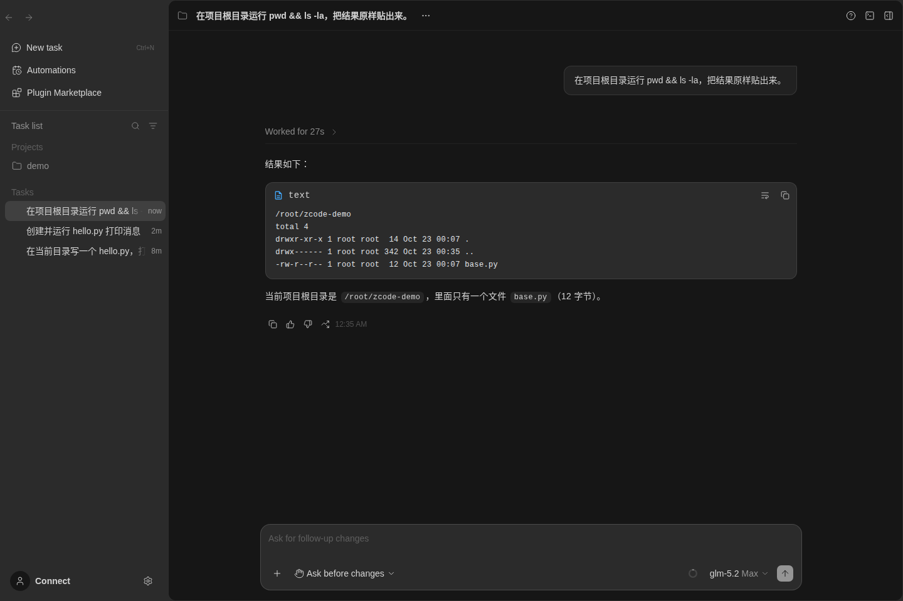

# ZCode Web Headless

**Run [ZCode](https://github.com/zai-org/ZCode)'s browser UI without the Electron desktop app.**
Create projects, edit files, run commands and chat with a model — all from `zcode --web`.

[](LICENSE)
[](https://github.com/zai-org/ZCode)
[-green)](docs/web-headless/ANDROID.zh-CN.md)

[简体中文](README.zh-CN.md) · [Deep dive (中文)](docs/web-headless/README.zh-CN.md) · [Android guide](docs/web-headless/ANDROID.zh-CN.md)



## The problem

ZCode ships three surfaces: desktop, web and TUI. But the web surface alone can't create anything —
every attempt fails with one of these:

```
project.host-offline          # "Failed to get system info" when picking a folder
project.remote-project-required  # "Failed to send" / "draft session creation failed"
```

The server binds project storage to a **Source Server identity**, while the browser always sends
`hostId: "local"`. The router treats `local` as a *different, offline machine*, so directory
browsing, project save and session reservation all fail.

That means: no desktop app → no projects → no chat. Even with a perfectly valid model endpoint.

## The fix

Two files, 54 lines. When the server is serving the web bundle, project storage is owned locally:

| File | Change |
|---|---|
| `packages/services/src/node.ts` | `createServerHostServices()` gains `localProjectStorage`; when on, `projectStorageHostId` is `undefined` (local owner) |
| `packages/server/src/entry-http.ts` | Enables it whenever `ZCODE_WEB_STATIC_ROOT` is set; `ZCODE_WEB_LOCAL_STORAGE=0` restores upstream behaviour |

Patch: [`patches/0001-web-local-project-storage.patch`](patches/0001-web-local-project-storage.patch)

## Quick start (prebuilt)

```bash
# 1. Download and unpack (built from this repo, v3.16.2)
curl -L -o zcode.tar.gz https://github.com/xiaozhe7772222/zcode-web-headless/releases/latest/download/zcode-3.16.2-linux.tar.gz
mkdir -p ~/zcode && tar -xzf zcode.tar.gz -C ~

# 2. Run (Node.js >= 24 required)
cd ~/zcode
node bin/zcode.mjs --web --workspace ~/projects/demo --port 3030 --no-open

# 3. Open http://127.0.0.1:3030
```

First project creation asks **Trust this folder?** — the agent can't touch the directory until you confirm.

## Build from source

```bash
export ELECTRON_SKIP_BINARY_DOWNLOAD=1

# Upstream build gap: @zcode/shared is source-only, SEA/TUI staging expects dist/.
# Web-only builds don't use TUI assets, so a stub is enough.
mkdir -p packages/shared/dist && printf 'export {};\n' > packages/shared/dist/index.js

pnpm install
pnpm build:bootstrap
pnpm build:zcode --base-url https://example.invalid/zcode/
```

## Docker

```bash
docker build -f Dockerfile.web -t zcode-web .
docker run --rm -p 3030:3030 -v "$PWD/project:/workspace" zcode-web
```

## Android

Unrooted phones work via Termux + `proot-distro` (chroot needs root, so it's not an option):

```bash
pkg install proot-distro termux-api
proot-distro install ubuntu   # then install linux-arm64 glibc Node 24 inside
termux-wake-lock
node ~/zcode/bin/zcode.mjs --web --workspace ~/projects/demo --port 3030 --no-open
```

Full steps, autostart and troubleshooting: [docs/web-headless/ANDROID.zh-CN.md](docs/web-headless/ANDROID.zh-CN.md).
Termux's own Node (Bionic) and Alpine (musl) won't load `node-pty` — use a glibc distro.

## Model configuration

Any OpenAI-compatible endpoint works. ZCode calls it with streaming, so the endpoint must support
`stream: true` reliably (non-streaming aggregation often hangs).

`~/.zcode/v2/provider_config.json`:

```json
{
  "schemaVersion": 1,
  "config": {
    "providerOrder": ["my-provider"],
    "providerConfigRules": {
      "providerRules": [{
        "providerId": "my-provider",
        "providerName": "My Provider",
        "config": {
          "group": "standard-personal",
          "access": { "type": "api-key", "apiKey": "<YOUR_API_KEY>" },
          "api": { "type": "openai-chat-completions", "baseUrl": "https://your-endpoint/v1" },
          "personalModelIds": ["glm-5.2"],
          "modelOrder": ["glm-5.2"]
        }
      }]
    },
    "modelConfigRules": {
      "providerModelRules": [
        { "modelId": "glm-5.2", "config": { "enabled": true }, "providerId": "my-provider" }
      ],
      "manualProviderModelRules": []
    }
  }
}
```

The UI's "API format" dropdown sometimes doesn't apply and silently saves `anthropic-messages`;
edit the JSON if that happens.

## Compatibility

| Check | Result |
|---|---|
| Upstream version | ZCode `v3.16.2` |
| Linux x86_64 | ✅ verified, full task end-to-end |
| Linux arm64 | ✅ verified under `qemu-aarch64-static` + `node-v24.14.0-linux-arm64` |
| Native modules on arm64 | ✅ `node-pty`, `ssh2`, `koffi` all load |
| Android (proot) | ⚠️ documented, not tested on a physical device |

Only `ssh2`'s crypto binding and `cpu-features` are compiled per-host, and they're only used for
remote SSH connections — local web mode doesn't load them. On arm64, re-run `pnpm install` to get
native builds, or rely on ssh2's JS fallback.

## Limitations

- Remote devices / SSH / WSL / Docker hosts still require the desktop host. This patch only makes
  the **local** web mode self-sufficient.
- Tasks without a project land in `~/.zcode/workspace/draft-<uuid>/` — upstream's draft workspace design.
- The server can read/write files and run commands. Keep it on `127.0.0.1`; `--host 0.0.0.0`
  generates an access token, don't leak the URL.

## Credits & license

Upstream: [zai-org/ZCode](https://github.com/zai-org/ZCode) (Apache-2.0), see [README.upstream.md](README.upstream.md).
Modifications here are released under the same license. `LICENSE`, `NOTICE.md` and
`THIRD-PARTY-NOTICES.md` are kept unchanged. Only the two files above differ from upstream `main`.
